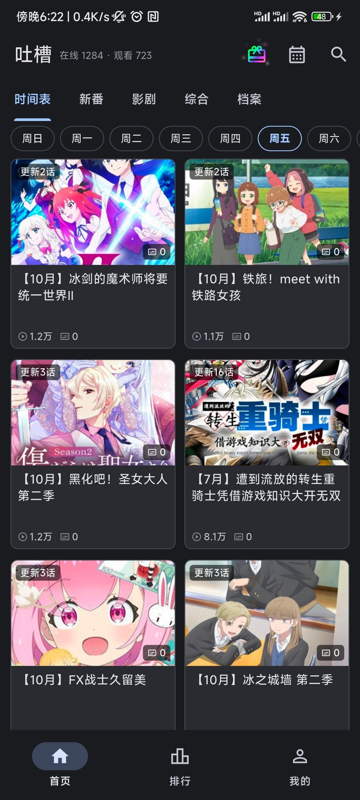
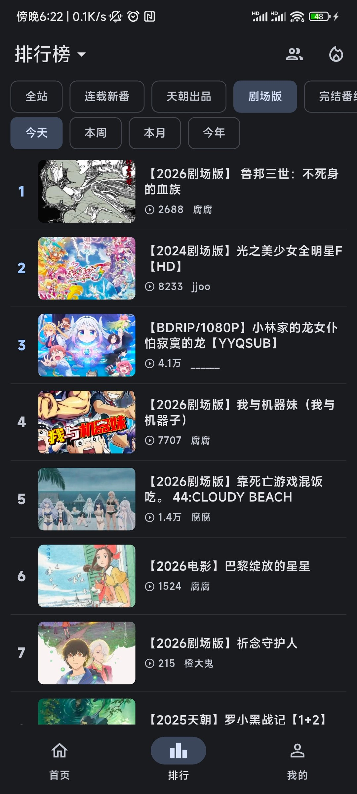
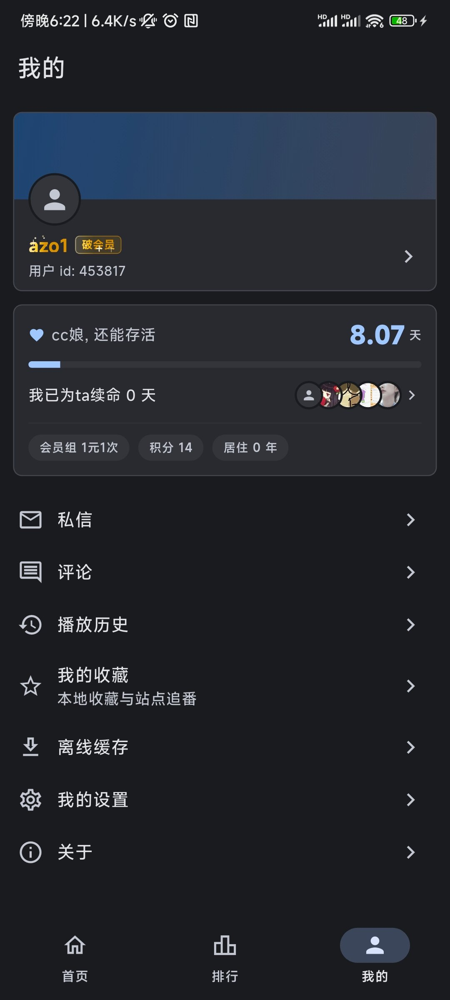

# 吐槽弹幕网客户端

Flutter 重建的吐槽弹幕网 (`tucao.my`) 第三方安卓客户端.
界面参考官方老版客户端与 PiliPlus, 接口沿用官方最新安卓端 `tucao-v2.0.4` 使用的定义.

本项目仅供学习交流, 与站点官方无关.

<p align="center">
  
  
  
</p>

## 功能

- 首页分区浏览: 新番 / 影剧 / 综合, 含子分区切换
- 首页时间表: 按周日到周六分组的新番时间表
- 分区列表: 支持按最新 / 弹幕 / 播放排序, 分页加载
- 排行榜: 全站与各分区, 今天 / 本周 / 本月 / 今年, 含神评论, 追番榜,
  无人区, 在线榜, 今天更新, 今天推荐与热搜榜
- u榜: 按用户维度排行, 点按进入用户空间
- 搜索: 关键词搜索, 分区过滤, 排序, 本地搜索历史与热搜推荐
- 番组: 新番索引按季度 / 年代 / 题材筛选, 本周新番按日期分组
- 档案: 站点档案列表与详情, 详情含播放 / 在线 / 评论统计与评论区
- 用户空间: 查看 up 主的资料与投稿, 头像与背景图可以点开放大 (双指缩放),
  放大后长按保存到相册
- 私信: 收件箱与会话详情, 支持发送与回复
- 评论: 我的页面列出自己发表过的评论, 点按跳回档案或视频, 作者可进空间
- 续命: 我的页面显示 cc娘还能存活的天数与本人累计续命天数, 带进度条,
  附会员组, 积分与账号年限, 点按进入贡献榜; 两个数值都取自站点会员中心
- 贡献榜: 按用户列出续命天数与占比条, 页脚可跳到站点说明续命规则的公告
- 广告: 首页礼物按钮进入广告列表, 点开用应用内 WebView 打开推广页
- 视频播放: 多分P, 倍速, 全屏, 画中画, 进度记忆, 复制分P链接与浏览器备用入口
- 屏幕适配: 手机竖屏单栏排布, 横屏与平板自动增加网格列数, 主框架改用侧边导航,
  播放页把简介与评论放到播放器右侧, 文字与表单页限制最大宽度并居中
- 播放统计: 播放页显示总播放量, 实时在线人数, 评论, 弹幕与追番数, 在线人数每 30 秒刷新;
  追番那一项与官网一致可以点击, 点一下追番, 再点取消
- 播放器手势: 横向拖动调进度, 移到顶部左右角可取消, 左侧竖向拖动调音量, 长按 3 倍速
- 跳过片头片尾: 播放器按钮按设置秒数前进, 秒数在设置页可调
- 画中画: 播放器按钮进入系统小窗, 回桌面或切到其他应用时也可自动进入,
  小窗只保留画面, 开关在设置页
- 投屏: 播放页搜索同网段的 DLNA 电视, 投屏时播放器区域变成电视遥控, 可在手机上拖动进度,
  暂停 / 继续 / 后退前进 10 秒 / 退出, 退出后本地从电视停下的位置接着放;
  手机侧起一个很小的转发服务补上站点直链需要的 Referer 与 UA, 避免电视因防盗链拉不到流;
  投屏期间画面由电视播放, 弹幕不显示
- 弹幕: 滚动 / 顶部 / 底部渲染, 播放中调整字号, 字重, 透明度, 时长, 描边,
  行高, 显示区域与字幕避让, 支持发送
- 评论: 播放页与档案详情都支持评论与站点表情, 含楼中楼, 点赞与发送;
  破会员可在顶层评论里发图评, 图片先传后发, 单张 2MB 以内
- 破会员: 登录后按站点的 vip 字段识别破会员身份, 我的页与用户空间页的昵称渲染成
  金色流光并飘几颗小粒子, 我的页昵称后附一枚同款小标签; 评论区的一级评论仍按站点的
  会员色标出破会员的 uid (多一次评论页请求); 图评入口对非破会员给出提示
- 播放历史: 本地记录进度, 可续播
- 本地收藏: 视频页收藏与取消, 收藏列表管理, 不与站点账号同步
- 站点追番: 追番跟着站点账号走, 播放页可添加与取消; 我的收藏页把本地收藏与追番
  合成一个入口, 里面分两个页签
- 离线缓存: 直链单文件分P多选, 前台下载队列, 暂停与从头重试, 本地播放与删除
- 登录与注册: 站点账号登录, 内置注册页, 修改密码与邮箱找回密码, cookie 持久化
- 我的页面: 顶部卡片把用户空间里的横幅铺在卡片上, 头像压在下沿, 没有横幅时用
  主题色渐变; 点卡片进入自己的用户空间
- 反馈: 我的页面可把意见以站点私信发给开发者, 需要登录, 正文自动附上应用版本
  与系统版本
- 设置: 主题, 播放器, 弹幕参数, 站点域名
- 站点域名: 站点更换域名时可在设置里改, 不必等新版应用, 保存后重启生效;
  构建时仍可用 SITE 指定默认域名
- 更新提示: 启动时查询 GitHub Release, 有新版本时按设备 ABI 挑出对应的安装包,
  在应用内前台下载, 回到后台即中断, 下载完成后交给系统安装器 (首次需允许本应用安装未知应用);
  对话框另附发布页与官网下载页 (非本人管理, 可能随时被撤去下载链接或更新延迟),
  可选择稍后或忽略该版本, 关于对话框可手动检查并查看下载进度

## 缓存说明

视频页菜单中的 "下载缓存" 支持选择可用直链分P, 在 "我的 - 离线缓存" 管理任务.
视频文件与任务清单放在 Android 提供的外部专属目录 `Android/data/com.azazo1.tucao/files/downloads/`,
不使用内部 `/data/data` 存放视频, 外部存储不可用时提示重试. 无需公共存储权限,
但 Android 11 及以上通常限制文件管理器访问该目录, 卸载应用会删除缓存.

当前仅支持单文件媒体, 不支持 HLS 分段缓存或后台下载. 暂停及失败后从头重试,
重启应用不会自动恢复流量. 下载响应若为网页, 错误文本或播放列表, 不会标为已缓存.
本地播放不请求站点详情或弹幕, 因此可以离线观看已完成的文件.

## 开发

项目使用 [just](https://github.com/casey/just) 编排常用命令, 按产品分子模块:
`just android ...` 是安卓应用, `just cli ...` 是命令行工具, `just mock ...` 是本地联调服务.

```shell
# 查看全部可用命令
just

# 获取依赖
just android deps

# 静态检查
just android analyze

# 运行测试
just android test

# 本地构建
just android build

# 在设备上运行
just android run

# 启动 mock 电视, 投屏联调用
just mock tv
```

投屏相关功能可以先用 mock 电视联调, 用法见 [docs/mock-tv.md](docs/mock-tv.md).

## 命令行工具

仓库里的 `cli/` 是一个 Go 写的命令行客户端, 覆盖浏览, 搜索, 榜单, 番组, 档案,
私信, 评论, 弹幕下载导出, 离线下载与账号管理, 输出支持 json 与 yaml, 便于脚本调用.

```shell
just cli build              # 构建到 cli/bin/tucao
just cli run --json rank    # 直接运行
just cli test               # 运行 Go 测试
```

用法, 配置位置与退出码见 [cli/README.md](cli/README.md).

## 构建

安卓构建依赖 JDK 17 与 Flutter stable.

```shell
just android build          # 构建 Release APK
just android build-split    # 按 ABI 拆分
just android build-debug    # 调试构建
```

发布构建的签名配置见 `android/key.properties.example`, 本地没有该文件时回落到调试签名.

## 持续集成

[CI 工作流](<.github/workflows/build.yml>) 在推送与合并请求时执行静态检查, 单元测试,
安卓构建, 以及命令行工具的构建与测试. 命令行工具是纯 Go 代码, 全部平台的产物由
一个 runner 交叉编译完成, 测试则在 Linux, Windows 与 macOS 上各跑一遍.

分支推送会更新同一个预发布 `dev-latest`: tag 只在首次创建时落位, 之后不再移动,
每次推送只替换该 release 的说明与按架构拆分的 apk 和 `tucao-cli-*` 命令行归档,
因此本地 `git fetch` 不会遇到同名 tag 指向变化. 页面上的 Commit 链接停留在首次
构建, 最新构建以 release 说明里的提交与版本为准. 正式发布由 `vX.Y.Z` tag 触发,
工作流校验 tag 与说明文件一致后, 把 apk 与 CLI 归档一并发布到该 tag 的 GitHub
Release, 校验和都在 `SHA256SUMS` 里.

## 接口

站点接口沿用官方安卓端定义, 集中登记在 `lib/http/api_path.dart`:

| 用途 | 地址 |
| --- | --- |
| 分区列表 | `api_v2/list.php` |
| 视频详情 | `api_v2/view.php` |
| 搜索 | `api_v2/search.php` |
| 弹幕 | `index.php?m=mukio&c=index&a=init` |
| 评论 | `index.php?m=comment&c=index&a=ajax` |
| 评论页 (会员标记) | `index.php?m=comment&c=index&a=init` (页面解析) |
| 图评上传 (破会员) | `index.php?m=comment&c=index&a=upload_img` |
| 登录状态 | `api.php?op=user` |
| 排行榜 | `html/hot.html` (页面解析) |
| 番组索引 | `bgm/` (页面解析) |
| 本周新番 | `html/week_bgm.html` (页面解析) |
| 用户空间 | `play/u{uid}/` (页面解析) |
| 注册 | `index.php?m=member&c=index&a=register` |
| 修改密码 | `index.php?m=member&c=index&a=account_manage_password` |
| 找回密码 | `index.php?m=member&c=index&a=public_forget_password` |
| 私信 | `index.php?m=message&c=index&a=inbox` (页面解析) |
| 评论列表 | `index.php?m=member&c=index&a=comment` (页面解析, 需登录) |
| 续命与贡献榜 | `index.php?m=member` 与 `index.php?m=member&c=life_rank` (页面解析, 需登录) |

站点的排行榜 json 接口 `rank.php` 与播放地址接口 `api/playurl` 都已废弃,
排行榜, 番组索引, 本周新番与用户空间没有可用的 json 接口, 这些页面通过
解析 html 获取数据, 与官方客户端早期版本的做法一致.

页面解析集中放在 `lib/http/` 下对应的 `*_http.dart`, 解析函数与请求分离,
便于用固定的页面样本做单元测试, 样本放在 `test/fixtures/`.

续命数据同样来自页面, 且会员中心与贡献榜都要登录态, 未登录时站点返回的是
会话过期的提示, 应用据此把续命卡片整块隐藏. 应用只读取站点已经算好的天数,
不替用户点击广告.

## 目录结构

```
lib/
  common/     常量, 主题, 公共组件, 分页基类
  http/       接口定义与请求实现
  models/     数据模型
  pages/      页面
  plugin/     播放器等独立插件
  router/     路由登记
  services/   账户, 历史, 主题等全局服务
  utils/      日志, 存储, 格式化等工具
```

## 许可

本项目基于 [MIT](LICENSE) 发布.
应用图标取自吐槽弹幕网官方客户端, 版权归原站点所有.
广告页的 CC 娘感谢素材由 AI 生成, 仅作娱乐用途, 不代表站点官方形象,
若版权方认为不妥会随时删除或替换.
